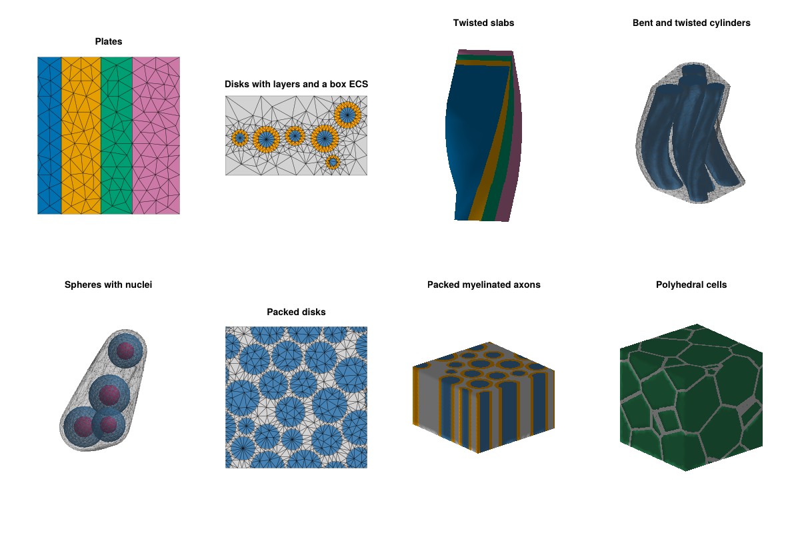
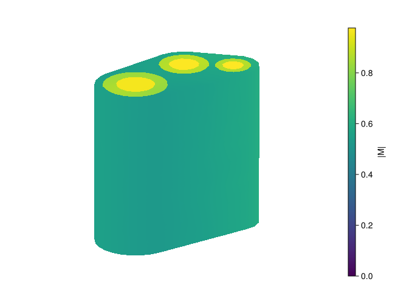
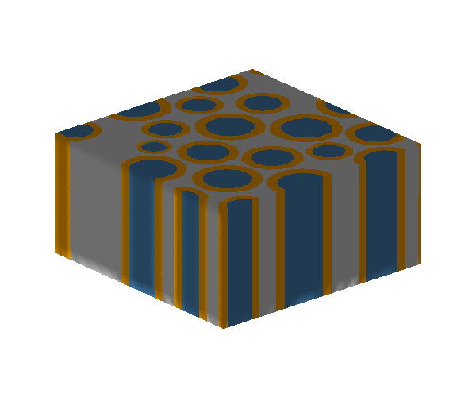
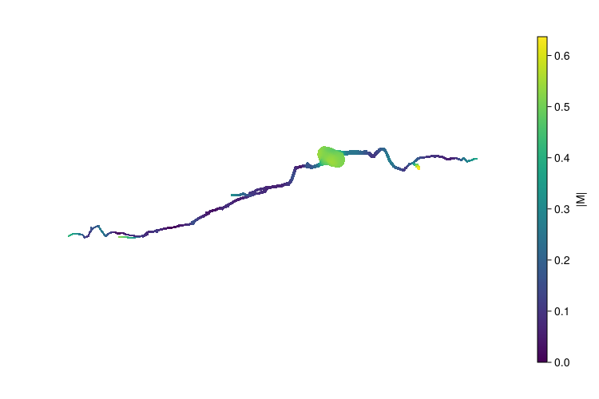
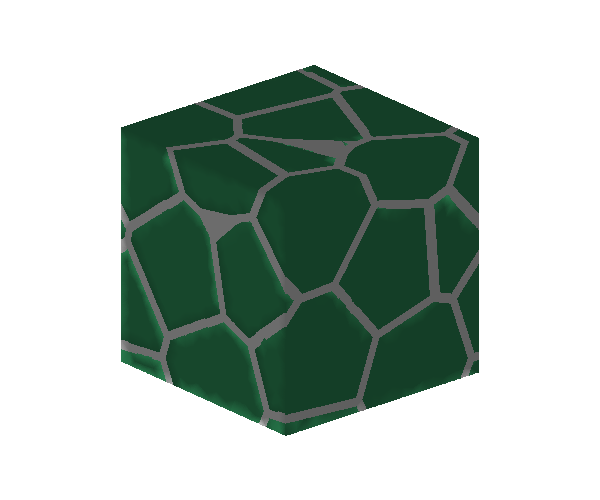
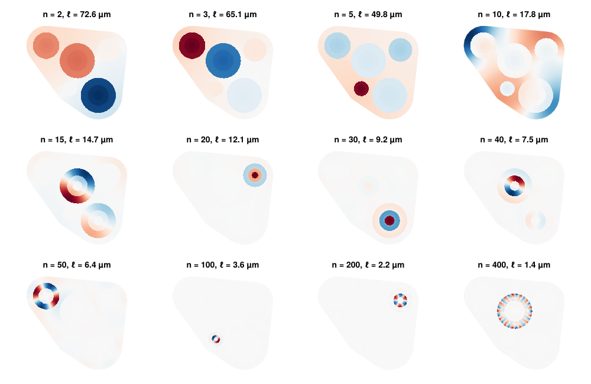
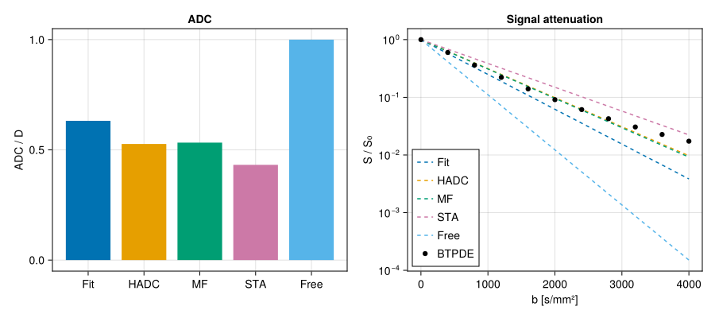

<div align="center">

<picture>
  <source media="(prefers-color-scheme: dark)" srcset="assets/logo_text_dark.svg">
  
</picture>

[](https://spindoctormri.github.io/SpinDoctor.jl/stable)
[](https://spindoctormri.github.io/SpinDoctor.jl/dev)
[](https://github.com/SpinDoctorMRI/SpinDoctor.jl/actions/workflows/UnitTest.yml)
[](https://codecov.io/gh/SpinDoctorMRI/SpinDoctor.jl)
[](https://github.com/JuliaTesting/Aqua.jl)

</div>

SpinDoctor simulates diffusion MRI in biological tissue. It solves the Bloch-Torrey
equation with finite elements on meshes of cells and tissue (axons, neurons, packed cells,
with layers, an extracellular space and permeable membranes), and computes signals and
apparent diffusion coefficients with several methods. This is the Julia version of the
[SpinDoctor](https://github.com/SpinDoctorMRI/SpinDoctor) MATLAB toolbox.



## Features

- **Geometries**: plates, slabs, disks, cylinders (bent, twisted), spheres, with layers
  (myelin, nuclei) and an extracellular space; dense samples of periodic tissue (packed
  cylinders, polyhedral cells); realistic neurons from
  [RealNeuronMeshes](https://github.com/SpinDoctorMRI/RealNeuronMeshes).
- **Signals**: the Bloch-Torrey equation for PGSE, double PGSE, OGSE and arbitrary
  three-dimensional gradient sequences, with permeable membranes, T2 relaxation and
  anisotropic diffusion.
- **ADCs**: fitted signals, the homogenized ADC model, the matrix formalism (Laplace
  eigenfunctions), the Kärger model and the short diffusion time approximation;
  analytical solutions for layered plates, cylinders and spheres.
- **Periodic boundary conditions** for samples of periodic tissue, free of the walls of a
  finite sample.
- **Fast**: multithreaded assembly, built-in time stepping with sparse direct solvers, and
  NVIDIA GPUs through CUDA and cuDSS.
- **Plots** of meshes, magnetizations and direction-dependent signals with Makie.

## Installation

SpinDoctor requires Julia 1.10 or later:

```julia
using Pkg
Pkg.add("SpinDoctor")
```

## Example

The signal of three myelinated axons in an extracellular space:

```julia
using SpinDoctor
using LinearAlgebra

setup = CylinderSetup(;
    ncell = 3,
    rmin = 2.0,
    rmax = 4.0,
    layersizes = [0.6, 1.0], # Axon and myelin
    ecs = ConvexHullECS(; margin = 1.0),
    height = 20.0,
)
mesh, surfaces, cells = create_geometry(setup)

# Coefficients of the layers and the ECS (micrometers and microseconds)
coeffs = coefficients(
    setup;
    D = (; cell = [0.002 * I(3), 0.0005 * I(3)], ecs = 0.002 * I(3)),
    T2 = (; cell = [Inf, Inf], ecs = Inf),
    rho = (; cell = [1.0, 1.0], ecs = 1.0),
    kappa = (; cell_interfaces = [1e-5], cell_boundaries = [0, 0], cell_ecs = 1e-5, ecs = 0),
    gamma = 2.67513e-4,
)
model = Model(; mesh, coeffs...)
matrices = assemble_matrices(model)

# PGSE sequence (δ = 5 ms, Δ = 20 ms) across the axons, b = 1000 s/mm²
gradient = ScalarGradient([1.0, 0.0, 0.0], PGSE(5000.0, 20000.0); bvalue = 1000, gamma = model.gamma)

u = solve_btpde(model, matrices, gradient)    # Magnetization at the echo time
signal = compute_signal(matrices.M, u)        # Signal
adcs = solve_hadc(model, matrices, gradient)  # ADC of each compartment
```

## Gallery

| [](https://spindoctormri.github.io/SpinDoctor.jl/dev/examples/generated/quickstart) | [](https://spindoctormri.github.io/SpinDoctor.jl/dev/examples/generated/white_matter) | [](https://spindoctormri.github.io/SpinDoctor.jl/dev/examples/generated/neuron) |
| :---: | :---: | :---: |
| Myelinated axons | White matter, with periodic boundaries | A spindle neuron |
| [](https://spindoctormri.github.io/SpinDoctor.jl/dev/examples/generated/periodic_tissue) | [](https://spindoctormri.github.io/SpinDoctor.jl/dev/examples/generated/matrix_formalism) | [](https://spindoctormri.github.io/SpinDoctor.jl/dev/examples/generated/compare_adcs) |
| Tortuosity of dense tissue | Laplace eigenfunctions | ADC methods |

The [documentation](https://spindoctormri.github.io/SpinDoctor.jl/dev) has all the
examples, with interactive figures, and the manual.

### Spinning spindle spins


The real part of the magnetization as a displacement, for the spindle neuron
`03b_spindle4aACC` from [NeuroMorpho.org](https://neuromorpho.org), during a PGSE sequence
in the x-direction (exported with `VTKWriter` and rendered with
[ParaView](https://www.paraview.org)).

## Citing

If you use SpinDoctor in your research, please cite it (see [CITATION.md](CITATION.md)).
